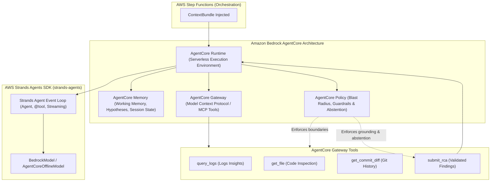

# Architecture

## Data flow
```
sample-service (Lambda, Python)  ──logs──►  CloudWatch Logs
        │                                     │ metric filter: ERROR|Traceback
        ▼                                     ▼
                                   CloudWatch Alarm (ALARM)
                                              │
                                   EventBridge rule (aws.cloudwatch / Alarm State Change)
                                              │  dedup: idempotency key = alarm + 15-min window (DynamoDB)
                                              ▼
                                   Step Functions: opspilot (Standard)
  ┌──────────────┬──────────────┬──────────────┬──────────────┬──────────────┬──────────────┐
  │ CollectCtx   │ RunRCA       │ Route        │ CreateTicket │ ProposeFix   │ Verify       │ Notify
  │ Lambda       │ Lambda →     │ Choice on    │ Lambda →     │ Lambda/      │ CodeBuild    │ Lambda →
  │ Logs Insights│ Bedrock      │ classification│ SSM OpsCenter│ Fargate →    │ (sync .sync) │ Slack webhook
  │ + CodeCommit │ Converse +   │ + confidence │              │ Bedrock +    │ repro test   │ + SNS email
  │ (file/commits) │ toolUse JSON│              │              │ CodeCommit PR│ main vs fix  │
  └──────────────┴──────────────┴──────────────┴──────────────┴──────────────┴──────────────┘
                     every step writes to DynamoDB `opspilot-incidents` (state + audit trail)
```

## Agent Architecture: AWS Strands Agents SDK & Amazon Bedrock AgentCore

OpsPilot uses **AWS Strands Agents SDK** (`strands-agents`) together with **Amazon Bedrock AgentCore** architecture patterns for enterprise-grade autonomous incident analysis and remediation.



### 1. AWS Strands Agents SDK (`strands-agents`)
AWS's open-source, model-driven agentic framework:
- **Autonomous Multi-Turn Reasoning:** `Agent` manages the conversational reasoning loop, handling `toolUse` events and feeding `toolResult` blocks back into the context.
- **Python-Native Tool Definition:** Functions decorated with `@tool` automatically generate OpenAPI and Bedrock-compatible schemas (`ToolSpec`), enabling type-safe parameters, descriptions, and automatic validation.
- **Model Backend Integration:** Uses `strands.models.BedrockModel` for live Amazon Bedrock Converse streaming (Claude 3.5 Sonnet / Amazon Nova Pro) and `AgentCoreOfflineModel` for deterministic, zero-credential testing.

### 2. Amazon Bedrock AgentCore
AWS's modular foundation for running agents in production:
- **AgentCore Runtime:** Serverless execution environment managing agent isolation, session lifecycles, and CloudWatch EMF (`OpsPilot/AgentCore`) performance telemetry.
- **AgentCore Gateway:** Model Context Protocol (MCP) compatible interface exposing diagnostic tools (`query_logs`, `get_file`, `get_commit_diff`, `submit_rca`) to the LLM with input schema enforcement.
- **AgentCore Policy:** Strict safety guardrails and blast-radius management:
  - *Patch limits:* At most 3 modified files and 80 changed lines.
  - *Protected paths:* Prohibits modifications to CI configs (`.github/`), IaC (`infra/`), contracts, or dependency manifests.
  - *Grounding verification:* Validates evidence references against context bundle logs, stack frames, and git commits (confidence penalty to <= 0.40 on unverifiable claims).
  - *Abstention rule:* Forces `insufficient_evidence` with confidence <= 0.40 when diagnostic traces are absent or inconclusive.
- **AgentCore Memory:** Persistent session working memory tracking evaluated hypotheses, ruled-out causes, notes, and tool invocation latency.
- **AgentCore Observability:** CloudWatch Embedded Metric Format (EMF) emitting `ExecutionDurationMs`, `ToolInvocations`, `PolicyViolations`, and `ConfidenceScore`.

## Components
| Component | AWS service | Responsibility | Inputs → outputs (schemas) |
|---|---|---|---|
| Ingest + dedup | EventBridge + DynamoDB conditional put | Skip duplicate alarms inside the window | alarm event → `incident_event` |
| CollectContext | Lambda | Logs Insights query (±10 min), parse the top stack trace, map frames to repo files, last N commits on those files | `incident_event` → `context_bundle` |
| RunRCA | Lambda + Bedrock Converse API | Tool-use loop (max 6 turns) with read-only tools: `query_logs`, `get_file`, `get_commit_diff`. Final answer forced through the `submit_rca` tool | `context_bundle` → `rca_result` |
| Route | Step Functions Choice | `confidence < 0.6` or `insufficient_evidence` → ticket+notify only | `rca_result` |
| CreateTicket | Lambda | AWS Systems Manager OpsCenter OpsItem (IAM auth): title, Markdown RCA description, Source `OpsPilot`, severity sev1-4 → OpsCenter severity 1-4 and priority 1-4, searchable operational data `opspilot:incident_id` (idempotency). Ticket id/URL/severity/status and a timeline are mirrored into the DynamoDB incidents table | `rca_result` + execution input → `ticket_ref` |
| ProposeFix | Lambda (Fargate if repo > 250 MB) | Shallow clone, Bedrock produces `{repro_test, patch}` as unified diffs, `git apply --check`, push `opspilot/<opsitem-id>`, open PR | `rca_result` + `ticket_ref` → `pr_ref` |
| Verify | CodeBuild (`startBuild.sync`) | 1) repro test on base must FAIL; 2) full suite + repro test on fix branch must PASS | `pr_ref` → `verification_result` |
| Notify | Lambda | Slack Block Kit message + SNS: classification, RCA summary, evidence, OpsItem link, PR link, verification verdict; mirrors the outcome onto the OpsItem (verified PR → InProgress, otherwise stays Open; never auto-Resolved) | all → message |

## Guardrails
- **Structured output only.** Bedrock tool schemas mirror contracts/rca_output.schema.json. Validate in Lambda; one repair retry, then route to `insufficient_evidence`.
- **Evidence grounding.** Each `evidence[].ref` must point to a log line ID or file:line that exists in the context bundle. Lambda checks this; unverifiable claims lower confidence to at most 0.4.
- **Patch limits.** At most 3 files and 80 changed lines. No changes to CI config, IaC or dependency manifests. If a patch breaks the limits, still file the ticket and add a note, but open no PR.
- **Retry cap.** If verification fails, ProposeFix runs one more time with the failure log. After that the PR is marked draft and a "needs human" label is added.
- **Secrets.** Ticketing (OpsCenter) and source control need no secrets. The optional Slack webhook lives in Secrets Manager. Incident Manager is not used: AWS closed it to new customers on 2025-11-07. Source control is AWS CodeCommit, reached with each Lambda's IAM role (no Git token at all). Log payloads are redacted (emails, tokens, IPs) before any Bedrock call.
- **Cost guard.** Max 1 RCA per alarm per 15 min; per-run token budget enforced in RunRCA.

## Observability of OpsPilot itself
Every run records: model ID, tokens in and out, tool calls, latency per step, classification, confidence, PR merged/closed/reverted (from CodeCommit pull-request events via EventBridge, later). These feed the eval metrics in IMPLEMENTATION_SPEC §M6.

## Deliberately out of scope for the POC
Multi-service causal analysis, metric anomaly detection, auto-merge or auto-deploy, multi-repo support, GitLab, Datadog/Sentry ingestion (the design is source-neutral: only CollectContext changes).
