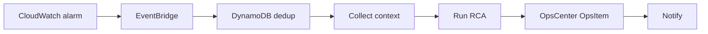
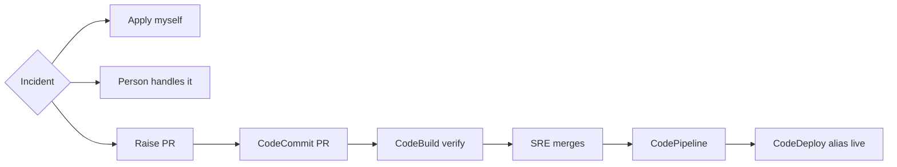
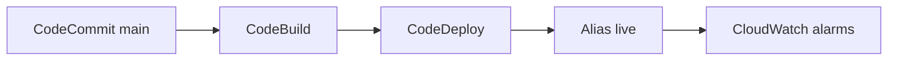
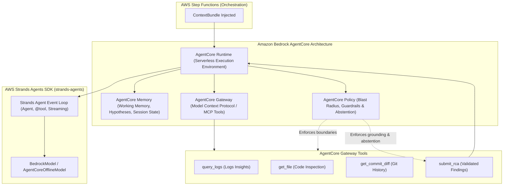

# Architecture

## Data flow

A CloudWatch alarm is analyzed and stopped before any pull request. An operator raises the pull request from the incident. Merging it to `main` is what deploys the storefront. Every step writes the incident to DynamoDB `opspilot-incidents`.

### Alarm path

State machine `opspilot` starts at Entry. An alarm has no `action`, so it takes CollectContext. Route always continues to Notify.

The alarm is a CloudWatch alarm on the storefront. Dedup is a 15-minute DynamoDB claim. Context reads CloudWatch Logs and CodeCommit. RCA is a Strands agent on Bedrock. The ticket is a Systems Manager OpsItem. Notify sends Slack and SNS.

### Operator path

The dashboard calls `propose_fix` in its own process. It does not start a second state-machine execution, so the alarm run cannot open another pull request. The state machine still contains ProposeFix and Verify, and Entry can reach them only when an execution is started with `action` `raise_pr`. The incident button does not start that execution.

Apply keeps the diff, offers copy, and can still raise a pull request. Person is the ending when no stub exists. Verify is CodeBuild project `opspilot-verify-fix` on the pull request branch. The result is commented on the pull request. OpsPilot does not merge and does not start the pipeline.

### Storefront

Repository `opspilot-sample-service`. A push to `main`, including a merged pull request, starts pipeline `opspilot-sample-service`. CodeDeploy moves the Lambda alias `live`. The same alias is what the alarms watch.

### How each planted fault ends

| Fault | Ending | What the stub changes |
|---|---|---|
| `get_order` | Pull request | Missing order returns 404 |
| `create_order` | Pull request | Missing `customer_id` returns 422 |
| `checkout` | Pull request | Unknown coupon returns 400 |
| `payment_status` | Pull request when it is a code defect | Legacy provider no longer sleeps |
| `inventory` | A person | Database timeout. No pull request |
| `export_report` | A person | Export runs out of memory. No pull request |

## Agent Architecture: AWS Strands Agents SDK & Amazon Bedrock AgentCore

OpsPilot uses **AWS Strands Agents SDK** (`strands-agents`) together with **Amazon Bedrock AgentCore** architecture patterns for enterprise-grade autonomous incident analysis and remediation.

### 1. AWS Strands Agents SDK (`strands-agents`)
AWS's open-source, model-driven agentic framework:
- **Autonomous Multi-Turn Reasoning:** `Agent` manages the conversational reasoning loop, handling `toolUse` events and feeding `toolResult` blocks back into the context.
- **Python-Native Tool Definition:** Functions decorated with `@tool` automatically generate OpenAPI and Bedrock-compatible schemas (`ToolSpec`), enabling type-safe parameters, descriptions, and automatic validation.
- **Model Backend Integration:** Uses `strands.models.BedrockModel` for live Amazon Bedrock Converse streaming (Claude 3.5 Sonnet / Amazon Nova Pro) and `AgentCoreOfflineModel` for deterministic, zero-credential testing.

### 2. Amazon Bedrock AgentCore
AWS's modular foundation for running agents in production:
- **AgentCore Runtime:** Serverless execution environment managing agent isolation, session lifecycles, and CloudWatch EMF (`OpsPilot/AgentCore`) performance telemetry.
- **AgentCore Gateway:** Model Context Protocol (MCP) compatible interface exposing diagnostic tools (`query_logs`, `get_file`, `get_commit_diff`, `submit_rca`) to the LLM with input schema enforcement.
- **AgentCore Policy:** Strict safety guardrails and blast-radius management:
  - *Patch limits:* At most 3 modified files and 80 changed lines.
  - *Protected paths:* Prohibits modifications to CI configs (`.github/`), IaC (`infra/`), contracts, or dependency manifests.
  - *Grounding verification:* Validates evidence references against context bundle logs, stack frames, and git commits (confidence penalty to <= 0.40 on unverifiable claims).
  - *Abstention rule:* Forces `insufficient_evidence` with confidence <= 0.40 when diagnostic traces are absent or inconclusive.
- **AgentCore Memory:** Persistent session working memory tracking evaluated hypotheses, ruled-out causes, notes, and tool invocation latency.
- **AgentCore Observability:** CloudWatch Embedded Metric Format (EMF) emitting `ExecutionDurationMs`, `ToolInvocations`, `PolicyViolations`, and `ConfidenceScore`.

## Components
| Component | AWS service | Responsibility | Inputs → outputs (schemas) |
|---|---|---|---|
| Ingest + dedup | EventBridge + DynamoDB conditional put | Skip duplicate alarms inside the window | alarm event → `incident_event` |
| CollectContext | Lambda | Logs Insights query (±10 min), parse the top stack trace, map frames to repo files, last N commits on those files | `incident_event` → `context_bundle` |
| RunRCA | Lambda + Bedrock Converse API | Tool-use loop (max 6 turns) with read-only tools: `query_logs`, `get_file`, `get_commit_diff`. Final answer forced through the `submit_rca` tool | `context_bundle` → `rca_result` |
| Route | Step Functions Choice | Always continues to Notify. The state machine does not open a pull request. A diff is offerable only for `code_defect` at confidence ≥ 0.6 with a stack frame (`route_rca`). | `rca_result` |
| CreateTicket | Lambda | AWS Systems Manager OpsCenter OpsItem (IAM auth): title, Markdown RCA description, Source `OpsPilot`, severity sev1-4 → OpsCenter severity 1-4 and priority 1-4, searchable operational data `opspilot:incident_id` (idempotency). Ticket id/URL/severity/status and a timeline are mirrored into the DynamoDB incidents table | `rca_result` + execution input → `ticket_ref` |
| ProposeFix | Dashboard process, CodeCommit | Not an alarm step. Raise PR commits the stub patch and repro test on `opspilot/<ticket>` for `get_order`, `create_order`, `checkout`, or `payment_status`, and opens one CodeCommit pull request. I'll apply changes myself stores that choice and opens nothing. Inventory and the report export have no generator. | `rca_result` + `ticket_ref` → `pr_ref` |
| Verify | CodeBuild `opspilot-verify-fix` | Started by the incident screen on the pull request branch. The repro test runs, and the pass or fail is commented on the pull request. The state machine's sync verify task is used only by an execution started with `action` `raise_pr`. | `pr_ref` → `verification_result` |
| Notify | Lambda | Slack Block Kit message + SNS: classification, RCA summary, evidence, OpsItem link, PR link, verification verdict; mirrors the outcome onto the OpsItem (verified PR → InProgress, otherwise stays Open; never auto-Resolved) | all → message |

## Guardrails
- **Structured output only.** Bedrock tool schemas mirror contracts/rca_output.schema.json. Validate in Lambda; one repair retry, then route to `insufficient_evidence`.
- **Evidence grounding.** Each `evidence[].ref` must point to a log line ID or file:line that exists in the context bundle. Lambda checks this; unverifiable claims lower confidence to at most 0.4.
- **Patch limits.** At most 3 files and 80 changed lines. No changes to CI config, IaC or dependency manifests. If a patch breaks the limits, still file the ticket and add a note, but open no PR.
- **Retry cap.** The patch is a deterministic stub, so a failed verification is not proposed again. The pull request stays open for a person. OpsPilot does not merge it.
- **Secrets.** Ticketing (OpsCenter) and source control need no secrets. The optional Slack webhook lives in Secrets Manager. Incident Manager is not used: AWS closed it to new customers on 2025-11-07. Source control is AWS CodeCommit, reached with each Lambda's IAM role (no Git token at all). Log payloads are redacted (emails, tokens, IPs) before any Bedrock call.
- **Cost guard.** Max 1 RCA per alarm per 15 min; per-run token budget enforced in RunRCA.

## Observability of OpsPilot itself
Every run records: model ID, tokens in and out, tool calls, latency per step, classification, confidence, PR merged/closed/reverted (from CodeCommit pull-request events via EventBridge, later). These feed the eval metrics in IMPLEMENTATION_SPEC §M6.

## Deliberately out of scope for the POC
Multi-service causal analysis, metric anomaly detection, auto-merge or auto-deploy, multi-repo support, GitLab, Datadog/Sentry ingestion (the design is source-neutral: only CollectContext changes).
