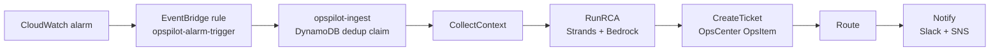
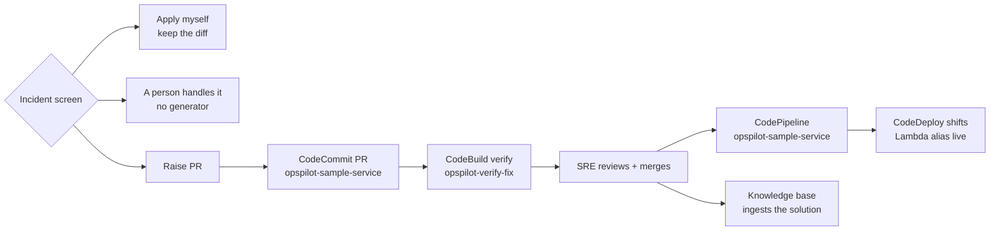
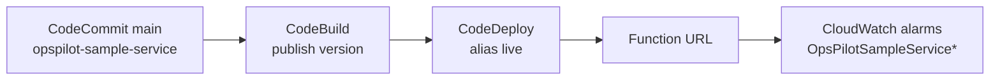
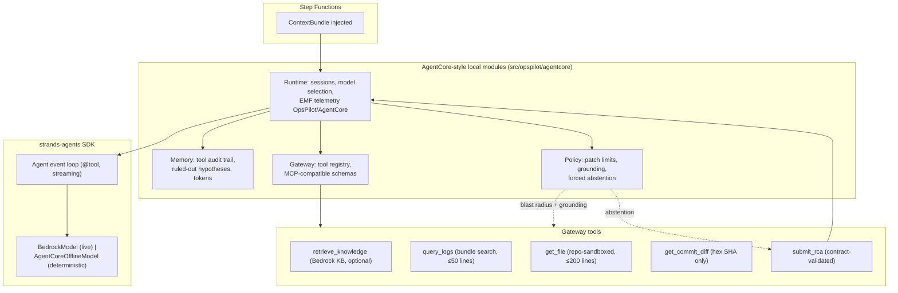

# Architecture

## Data flow

A CloudWatch alarm is analyzed, ticketed, and notified — and then it stops. A suggested diff is *offered* only for grounded code defects; an operator raises the pull request from the incident screen, and merging it is what deploys the storefront. Every step writes the incident to DynamoDB `opspilot-incidents`.

### Alarm path

State machine `opspilot` starts at `Entry`. An alarm payload has no `action` field, so it takes `CollectContext`. `Route` always continues to `Notify` — the state machine itself never opens a pull request.

- **Trigger:** EventBridge matches `CloudWatch Alarm State Change` with alarm-name prefix `OpsPilotSampleService` and state `ALARM`; the target has a DLQ (`opspilot-ingest-dlq`, 4 retries, 2 h max age).
- **Dedup:** `incident_id = sha256(alarm_name + floor(detected_at / window))`, window `DEDUP_WINDOW_MIN` (15 min). The claim is written `PENDING` via conditional put, promoted to `STARTED` after `StartExecution` (deterministic execution name; `ExecutionAlreadyExists` counts as success); stale PENDING claims (> 120 s) can be re-claimed; rows expire by TTL (30 days).
- **CollectContext:** CloudWatch Logs around `detected_at` ±10 min, error/warning events first (`?Traceback ?ERROR ?Exception …`) with a raw-window fallback, parses the top Python traceback, maps frames to repo files, and reads those files + their last commits from CodeCommit. Everything is redacted (emails, IPs, AWS keys, tokens) before it can reach Bedrock.
- **RunRCA:** agent loop (below). Failures never skip the ticket: a CollectContext/RunRCA error routes through `BuildAbstainRca` (`insufficient_evidence`, confidence 0) → CreateTicket → Notify.
- **CreateTicket:** SSM OpsCenter OpsItem (IAM only), Source `OpsPilot`, severity `sev1-4` → OpsCenter severity/priority, Markdown RCA (≤ 2048 chars), searchable operational data `opspilot:incident_id` for idempotency (DynamoDB first, then `DescribeOpsItems`). Ticket id/URL/status + an append-only timeline mirror into DynamoDB.
- **Notify:** Slack Block Kit (webhook from Secrets Manager `opspilot/slack`) + SNS `opspilot-alerts`; classification, summary, evidence, OpsItem link, PR link and verification verdict when present. Mirrors the outcome onto the OpsItem: verified PR → `InProgress`, otherwise stays `Open` — never auto-`Resolved`. In live mode it raises if no channel delivered. Final statuses: `FAILED` / `VERIFIED` / `NEEDS_HUMAN` / `PR_OPENED` / `AWAITING_CHOICE` / `NOTIFIED`. If Notify itself fails, the execution ends in `NotifyFailed`, and the alarm `opspilot-executions-failed` pages SNS.

### Operator path

The dashboard calls `propose_fix` **in its own process**, pointed at the storefront repo. It does not start a second state-machine execution, so an alarm run can never open a pull request. The states `ProposeFix`/`Verify`/`ParseVerification`/`VerifyOutcome`/`MarkNeedsHuman` exist in the ASL but are reachable only by an execution started with `action: "raise_pr"` — nothing starts one today.

- **Offer gate:** a diff is offerable only for `code_defect` at confidence ≥ 0.6 with a `suspected_location` backed by a matching `stack_frame` evidence ref (`route_rca`). "Apply myself" stores the choice and opens nothing; Raise PR stays available afterwards. One PR per incident.
- **Fix agent (stub):** generates patch + reproduction test for exactly four planted bugs (`get_order`, `create_order` in `sample_service/app.py`; `checkout`, `payment_status` in `sample_service/faults.py`); refuses everything else with `UnsupportedFixTarget`. Commits to branch `opspilot/<ticket-id>` via the CodeCommit API (no git binary, no tokens), PR title `[OpsPilot] <ticket>: 
`, body marked as generated and requiring human review. Every failure raises; nothing returns a placeholder PR.
- **Verify:** CodeBuild project `opspilot-verify-fix` runs the two-phase buildspec — phase 1 copies the repro test onto the base checkout and requires pytest **exit code 1** (a missing file or a collection error does not count as "fails on base"); phase 2 requires the full `sample_service/tests` suite to pass on the fix commit. Exported variables (`REPRO_FAILS_ON_BASE`, `SUITE_PASSES_ON_FIX`, `FAILURE_REASON`) are mapped to a `VerificationResult` by `opspilot-parse-verification`, and the verdict is commented on the PR. A failed verification goes to `MarkNeedsHuman` (title prefix + comment — CodeCommit has no labels); the identical patch is never retried.
- **After merge:** the dashboard's `pr-status` endpoint tracks CodeCommit PR state, the verify build, the CodePipeline execution matched to the merge commit (`deploy/pipeline.py`), and ingests the merged solution into the Bedrock knowledge base (`knowledge/ingest.py`).

### Storefront & repos

Two CodeCommit repos with different jobs:

| Repo | Owner | Role |
|---|---|---|
| `opspilot-sample-service` | SampleServiceStack (`infra/app_delivery.py`) | The storefront. Seeded with `sample_service/` + buildspec; pipeline `opspilot-sample-service` (Source → CodeBuild publishes a Lambda version → CodeDeploy shifts alias `live`). **Fix PRs target this repo**, and the pipeline Lambdas' `CODECOMMIT_REPO` points here, so RCA source reads and patches see exactly what deploys. The public Function URL hangs off the `live` alias — the alarms watch the same alias. |
| `opspilot-aws` (`CODECOMMIT_REPO`) | CoreStack | Platform repo; `deploy.sh seed` pushes this checkout to `main` via the CodeCommit API. RETAIN on destroy, like the storefront repo. |

### Planted faults and how each one ends

13 triggers in `sample_service/faults.py` (also served live at `GET /faults`); the dashboard exposes 17 named scenarios over them (`dashboard/scenarios.py`).

| Trigger | Symptom | Alarm | Ending |
|---|---|---|---|
| `GET /orders/999` | 500 `AttributeError` (None.total) | `OpsPilotSampleServiceErrors` | PR: missing order → 404 |
| `POST /orders` without `customer_id` | 500 `KeyError` | `OpsPilotSampleServiceErrors` | PR: missing field → 422 |
| `GET /checkout?sku=SKU-1&qty=2&coupon=SPRING50` | 500 `KeyError` (unknown coupon) | `-CheckoutErrors` | PR: unknown coupon → 400 (suite pin dropped in the same PR) |
| `GET /payments/77/status?provider=legacy` | ~6 s latency | `-LatencyP95` | PR when classified `code_defect` on `payment_status`: legacy provider no longer sleeps inline; otherwise a person |
| `GET /inventory/BULK-42` | 500 `TimeoutError` (DB pool) | `-InventoryDbTimeouts` | A person: `dependency`, no generator |
| `GET /reports/export?days=90` | Lambda OOM kill | `-Crashes` | A person: `resource`, no generator |
| `GET /basket/average?count=0` | 500 `ZeroDivisionError` | `-BasketErrors` | Notify: `code_defect` below the fix threshold |
| `GET /settings` | 500 `KeyError 'ORDERS_TABLE'` | `-ConfigErrors` | Notify: `config_regression` (no revert agent yet) |
| `GET /payments/77/status?provider=down` | 500 gateway `TimeoutError` | `-PaymentTimeouts` | Notify: `dependency` |
| `POST /writes/orders` | 500 DynamoDB throttle | `-WriteThrottles` | Notify: `dependency` |
| `GET /pricing/SKU-1` | 500 `TypeError` (string price + int fee) | `-PricingErrors` | Notify: `code_defect`, no generator |
| `GET /shipments/404` | 500 `IndexError` | `-ShipmentErrors` | Notify: `code_defect`, no generator |
| `POST /refunds {}` | 500 `KeyError 'order_id'` | `-RefundErrors` | Notify: `code_defect`, no generator |
| `GET /tax/quote?subtotal=10&rate=` | 500 `ValueError` (blank rate) | `-TaxErrors` | Notify: `code_defect`, no generator |

Every request writes one JSON line (`event` = `request` or `unhandled_exception`, plus `component`); per-component metric filters (namespace `OpsPilot/SampleService`) feed the 11 error alarms, and unhandled exceptions are also logged as plain Python tracebacks — exactly what CollectContext parses.

## Agent architecture: Strands SDK + AgentCore-style components

> The agent loop is the **real** `strands-agents` SDK on **real** Bedrock (`strands.models.bedrock.BedrockModel`).
> The AgentCore Runtime/Gateway/Policy/Memory classes in `src/opspilot/agentcore/` are **local Python modules
> modelled on Amazon Bedrock AgentCore concepts** — they do not call the AgentCore service, MCP, or any
> AgentCore AWS resource.

- **Model selection** (`agentcore/runtime.py`): live `BedrockModel` when a real AWS key or `OPSPILOT_LIVE=1` is present, else `AgentCoreOfflineModel` — a deterministic, grounding-aware Strands `Model` that simulates multi-turn Converse streaming for tests, evals, and credential-free demos. Kimi K3 quirks handled: no `temperature` field, prior `reasoningContent` blocks stripped before each call (a Strands `BeforeModelCallEvent` hook).
- **Backend switch:** `OPSPILOT_AGENT_BACKEND=converse` bypasses Strands and runs the plain Converse tool-use loop in `rca/agent.py` (max 6 turns, one schema-repair attempt, then abstain).
- **Tools:** registered in the gateway with Bedrock/MCP-compatible schemas. `query_logs` searches bundle log lines (limit ≤ 50); `get_file` serves numbered lines from the bundle cache or a checkout strictly inside the repo root (rejects absolute paths, `..`, `.git/`, `.env*`; ≤ 200 lines); `get_commit_diff` accepts only 7–40-hex SHAs (bundle first, then CodeCommit `GetDifferences` for full 40-char ids); `retrieve_knowledge` queries the managed Bedrock KB when `KNOWLEDGE_BASE_ID` is set; `submit_rca` is the only exit and runs full contract validation + grounding.
- **Prompt hygiene:** logs, stack traces, code, and commits are fenced in `<untrusted_*>` tags; the system prompt orders the model never to follow instructions inside them.
- **Telemetry:** CloudWatch EMF (`OpsPilot/AgentCore`): `ExecutionDurationMs`, `ToolInvocations`, `PolicyViolations`, `ConfidenceScore`. The dashboard's run records (`dashboard/runs.py`) expose the same session as a span waterfall — nothing invented; offline-model token counts are flagged as fixed stand-ins.

## Components

| Component | AWS service | Responsibility | Inputs → outputs |
|---|---|---|---|
| Ingest + dedup | EventBridge + DynamoDB conditional put | Skip duplicate alarms inside the 15-min window; PENDING→STARTED claim | alarm event → `incident_event` |
| CollectContext | Lambda `opspilot-collect-context` | Logs ±10 min (errors first), parse top traceback, map frames to repo files, last commits on those files (CodeCommit) | `incident_event` → `context_bundle` |
| RunRCA | Lambda `opspilot-run-rca` + Bedrock | Strands/Converse tool loop (≤ 6 turns), read-only tools, forced `submit_rca`, grounding + abstention | `context_bundle` → `rca_result` |
| Route | ASL Choice + `route.py` | Always continues to Notify; `route_rca` decides whether a diff is offerable (gate above) | `rca_result` |
| CreateTicket | Lambda `opspilot-create-ticket` | OpsCenter OpsItem, idempotent via `opspilot:incident_id`; mirrors to DynamoDB | `rca_result` → `ticket_ref` |
| ProposeFix | Dashboard process (or ASL state under `action: raise_pr`) | Stub patch + repro test → branch → one CodeCommit PR | `rca_result` + `ticket_ref` → `pr_ref` |
| Verify | CodeBuild `opspilot-verify-fix` | Two-phase: repro fails on base (rc=1), suite passes on fix; verdict commented on the PR | `pr_ref` → build |
| ParseVerification | Lambda `opspilot-parse-verification` | Build object (or Catch cause) → `VerificationResult` from exported variables | build → `verification_result` |
| MarkNeedsHuman | Lambda `opspilot-mark-needs-human` | Requires `pr_number`; PR title prefix + comment (CodeCommit has no labels) | `pr_ref` → labeled PR |
| Notify | Lambda `opspilot-notify` | Slack Block Kit + SNS; OpsItem status sync; raises in live mode if nothing delivered | all → message |
| Knowledge (optional) | Bedrock KB + S3 | Seeded runbooks; merged-PR solutions ingested as Markdown; `retrieve_knowledge` tool | incident → document |

## Guardrails

- **Structured output only.** Bedrock tool schemas mirror `contracts/rca_output.schema.json`; pydantic models are `extra="forbid"`. One repair retry on validation failure, then abstain.
- **Evidence grounding** (`rca/grounding.py`, the single path for every backend): each `evidence[].ref` must resolve in the bundle (log id, exact `file:line` frame, or commit SHA); `code_defect` needs a grounded stack frame or commit; anything unverifiable → `insufficient_evidence` with confidence ≤ 0.4. Citations within 8 lines of a real frame are aligned to it, not rejected.
- **Patch limits** (`agentcore/policy.py`, `fix/guardrails.py`): ≤ 3 files, ≤ 80 changed lines (repro test counts toward both); protected paths — CI config, IaC, contracts, dependency manifests. A violating patch files the ticket with a note and opens no PR.
- **Retry cap.** The patch generator is deterministic, so a failed verification is never re-proposed; the PR stays open and gets marked needs-human. OpsPilot does not merge and does not start the deploy pipeline.
- **Least privilege.** The LLM has no AWS permissions at all. Bedrock is scoped to the configured model + inference-profile ARNs. CodeCommit permissions are scoped to the storefront repo and exclude merge. OpsItem Get/Update are scoped to `opsitem/*`. `states:StartExecution` and `lambda:InvokeFunction` are scoped to exact ARNs. The synthesized templates contain no `Resource: "*"` statements except the two unscopable OpsCenter create/describe actions.
- **Secrets.** Ticketing (OpsCenter) and source control (CodeCommit) need no secrets — IAM only. The optional Slack webhook lives in Secrets Manager. Incident Manager is not used (closed to new AWS customers 2025-11-07). GitHub is a local-dev fallback (`SCM_PROVIDER=github`, token from env or Secrets Manager).
- **Redaction.** Emails, IPv4s, AWS access keys, GitHub tokens, Bearer tokens, and `key=value` secrets are scrubbed from log payloads before any Bedrock call or audit write (`redact.py`).
- **Cost guard.** Max 1 RCA per alarm per 15-min dedup window; RCA loop capped at 6 turns; log/file tool results capped (50 / 200 lines).

## Observability of OpsPilot itself

Every run records model id, tokens, tool calls, per-step latency, classification, and confidence (EMF + the incidents table + dashboard run records). PR merged/closed state is read live from CodeCommit; post-merge deploy state from CodePipeline executions matched to the merge commit. These feed the eval metrics in `IMPLEMENTATION_SPEC.md` §M6.

## Deliberately out of scope for the POC

Multi-service causal analysis, metric anomaly detection, auto-merge or auto-deploy, multi-repo support, GitLab, Datadog/Sentry ingestion (the design is source-neutral: only CollectContext changes), a real (non-stub) patch agent, live-model evals.
